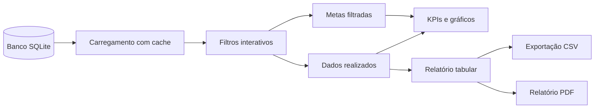

# 📊 Dashboard de Vendas — Python e Streamlit

> Aplicação interativa para análise de vendas, comparação entre realizado e meta, visualização de indicadores comerciais e exportação de dados em CSV e PDF.

[](https://www.python.org/)
[](https://streamlit.io/)
[](https://pandas.pydata.org/)
[](https://plotly.com/python/)
[](https://www.sqlite.org/)

---

# 🌐 Acesso ao aplicativo

A aplicação está publicada no Streamlit Community Cloud e pode ser acessada pelo link abaixo:

**[Abrir o Dashboard de Vendas](https://dashboard-vendas-python.streamlit.app)**

---

# 📋 Sobre o projeto

O **Dashboard de Vendas** é uma aplicação desenvolvida em Python e Streamlit para transformar registros comerciais armazenados em um banco SQLite em uma interface analítica interativa.

O projeto apresenta uma solução completa para exploração de dados de vendas, permitindo analisar receitas, quantidades, ticket médio, transações, desempenho regional, categorias, produtos e evolução temporal.

Além dos indicadores e gráficos, a aplicação disponibiliza uma comparação entre o faturamento realizado e uma meta detalhada por período, região, categoria e produto. Os dados filtrados também podem ser exportados em CSV e PDF.

Este projeto foi desenvolvido como um estudo prático de Python, análise de dados, desenvolvimento de Data Apps, banco de dados, visualização e organização modular de software.

---

## 🎯 Objetivo

O objetivo é demonstrar como construir uma aplicação analítica funcional utilizando tecnologias acessíveis e de código aberto.

A aplicação foi estruturada para permitir que o usuário:

- acompanhe indicadores de vendas;
- filtre os dados por diferentes dimensões comerciais;
- compare o resultado realizado com uma meta planejada;
- visualize padrões e tendências por meio de gráficos;
- consulte os dados em formato tabular;
- exporte os resultados filtrados para utilização posterior.

O projeto também demonstra a evolução de uma aplicação inicialmente desenvolvida como estudo de curso para uma estrutura mais organizada e adequada à apresentação em um portfólio profissional.

---

# 💡 O problema

Dados de vendas armazenados em um banco SQLite podem conter informações relevantes para a análise comercial, mas a ausência de uma interface visual dificulta a interpretação e o acompanhamento dos resultados.

Sem um dashboard interativo, perguntas como as seguintes podem exigir consultas manuais, planilhas ou etapas adicionais de tratamento:

- Qual foi a receita total em determinado período?
- Quais regiões apresentam melhor desempenho?
- Quais categorias e produtos possuem maior participação no faturamento?
- O valor realizado ficou acima ou abaixo da meta?
- Como o resultado muda quando diferentes filtros são combinados?
- Como acompanhar a evolução das vendas ao longo do tempo?
- Como exportar os dados filtrados para compartilhamento ou análise posterior?

Outro desafio é garantir que a comparação entre realizado e meta permaneça coerente após a aplicação dos filtros. A meta precisa acompanhar o mesmo período, região, categoria e produto selecionados pelo usuário.

Também é necessário tratar períodos parciais. Quando o usuário analisa apenas parte de um mês, comparar o realizado com a meta mensal integral pode distorcer a interpretação do resultado. Nesse caso, a meta precisa ser ajustada proporcionalmente à quantidade de dias selecionados.

Além do desafio técnico e analítico, algumas empresas, especialmente pequenos negócios ou operações em fase de estruturação, podem não considerar prioritário o investimento inicial em plataformas proprietárias de Business Intelligence.

Nesse contexto, uma solução desenvolvida com Python, SQLite e Streamlit pode representar uma alternativa de baixo custo para centralizar indicadores comerciais, apoiar a tomada de decisão e validar necessidades de negócio antes da adoção de uma plataforma corporativa mais robusta.

O objetivo não é substituir sistemas ERP, CRM ou ferramentas corporativas em cenários de maior complexidade. A proposta é demonstrar uma solução enxuta, acessível e extensível para análise de vendas, protótipos internos e projetos de gestão comercial.

---

# 🛠️ A solução

A aplicação reúne os dados de vendas e as metas em um fluxo analítico único:



O usuário seleciona o período e os filtros comerciais na barra lateral. A aplicação utiliza essas seleções tanto para filtrar as vendas realizadas quanto para localizar as metas correspondentes.

Quando o intervalo selecionado corresponde a apenas parte de um mês, a meta é calculada proporcionalmente aos dias analisados. Dessa forma, a comparação entre realizado e meta permanece coerente com o período escolhido.

---

# ✨ Principais funcionalidades

### 🔍 Filtros interativos

A barra lateral permite filtrar os dados por:

- período de análise;
- região;
- categoria;
- produto.

Os filtros podem ser combinados para realizar análises gerais ou detalhadas.

### 📶 Indicadores de desempenho

O dashboard apresenta cards com os principais indicadores do conjunto filtrado:

- **Receita Total:** soma do faturamento dos registros filtrados;
- **Vendas em quantidade:** total de unidades vendidas;
- **Valor Médio por Unidade:** faturamento total dividido pela quantidade total vendida;
- **Registros de vendas:** quantidade de linhas retornadas após a aplicação dos filtros.

O card de Receita Total também apresenta a comparação percentual entre o realizado e a meta filtrada.

### 📈 Comparação entre realizado e meta

A aplicação compara o faturamento realizado com a meta correspondente aos filtros selecionados.

A meta é detalhada por:

```text
período + região + categoria + produto
```

O resultado pode indicar desempenho acima ou abaixo da meta, com diferenciação visual no card de Receita Total.

### 📊 Gráficos analíticos

O dashboard possui cinco visualizações analíticas:

- **Evolução da Receita Diária:** acompanha o faturamento ao longo do período selecionado;
- **Mix de Categorias:** apresenta a participação das categorias na receita total;
- **Performance Regional:** compara o faturamento entre as regiões;
- **Análise por Dia da Semana:** apresenta a receita média por dia da semana;
- **Dispersão Quantidade x Faturamento:** relaciona a quantidade vendida e o faturamento, utilizando categorias e produtos como dimensões visuais.

Os gráficos são organizados em cards visuais para melhorar a leitura e a separação entre os diferentes blocos analíticos.

### 📸 Screenshot


### 📝 Relatório tabular

A aplicação apresenta uma guia com os dados detalhados após a aplicação dos filtros.

A visualização tabular permite consultar os registros selecionados e verificar as informações utilizadas nos indicadores e gráficos.

### 📸 Screenshot


### 🧾 Exportação CSV

Os dados filtrados podem ser exportados para um arquivo CSV, permitindo análises complementares em planilhas ou outras ferramentas de dados.

O arquivo CSV contém:

- todas as linhas do relatório após a aplicação dos filtros;
- todas as colunas dos registros selecionados;
- os dados completos de cada venda encontrada no período e nas dimensões comerciais escolhidas.

Essa opção é indicada quando o usuário precisa trabalhar com a base detalhada, realizar novos cálculos ou utilizar os registros em outra ferramenta de análise.

### 📥 Exportação de relatório executivo em PDF

A aplicação permite gerar um relatório executivo em PDF com um resumo dos dados filtrados.

Diferentemente do CSV, o PDF não apresenta todas as linhas do relatório. Ele foi projetado para uma visualização gerencial mais objetiva e contém:

- Receita Total;
- Quantidade total vendida;
- Ticket Médio;
- as 15 vendas com maior faturamento dentro do filtro selecionado.

As vendas são ordenadas de forma decrescente pelo campo de faturamento. Quando o filtro selecionado possui menos de 15 registros, o relatório apresenta todos os registros disponíveis.

O fluxo de exportação possui duas etapas:

1. gerar o relatório com os filtros atuais;
2. liberar o download do PDF gerado.

Se o usuário alterar os filtros depois de gerar o relatório, o PDF anterior é invalidado. O download permanece desabilitado até que um novo relatório seja gerado com os dados atualizados.

Essa opção é indicada para compartilhar um resumo executivo ou apresentar rapidamente os principais resultados do período analisado.

### 📸 Screenshot


### 🌓 Temas claro e escuro

A interface pode ser utilizada nos temas claro e escuro do Streamlit, com estilos personalizados para preservar a legibilidade dos cards, gráficos, filtros e demais componentes.

### Layout responsivo

A aplicação utiliza o layout amplo do Streamlit, colunas responsivas, cards e componentes compactos na barra lateral para melhorar a utilização em diferentes tamanhos de tela e níveis de zoom do navegador.

---

## Regra de negócio das metas

A base do projeto possui duas estruturas principais:

```text
tb_vendas
    registros de vendas realizadas

tb_metas
    metas planejadas por período, região, categoria e produto
```

### Período das vendas realizadas

A tabela `tb_vendas` contém os registros realizados de:

```text
01/01/2026 a 31/10/2026
```

Novembro e dezembro não possuem vendas realizadas no cenário analisado, pois são considerados meses ainda não encerrados.

### Período das metas

A tabela `tb_metas` contém metas planejadas para todo o ano de 2026:

```text
01/11/2026 a 31/12/2026
```

Dessa forma, novembro e dezembro já possuem metas preparadas, mas ainda não possuem valores realizados no banco de vendas.

### Metas detalhadas

As metas são consultadas no mesmo nível dos filtros comerciais:

```text
período
região
categoria
produto
```

Quando o usuário altera os filtros, a aplicação recalcula a meta correspondente ao novo conjunto de dados selecionado.

### Rateio para períodos parciais

Quando o período selecionado inclui apenas parte de um mês, a aplicação calcula a meta proporcionalmente aos dias selecionados:

```text
Meta proporcional =
meta mensal × dias selecionados ÷ quantidade de dias do mês
```

Por exemplo, ao selecionar de 01/02/2026 a 15/02/2026, são considerados 15 dos 28 dias de fevereiro.

Essa regra evita comparar vendas realizadas em apenas parte de um mês com a meta integral do mês.

---

## Arquitetura modular

A aplicação foi dividida em módulos com responsabilidades específicas:

| Arquivo | Responsabilidade |
|---|---|
| `app.py` | Orquestração principal da aplicação e fluxo entre os módulos |
| `config.py` | Configuração inicial da página Streamlit |
| `styles.py` | Tema visual e estilos CSS personalizados |
| `sidebar.py` | Sidebar, filtros e seleção do período |
| `data_loader.py` | Carregamento cacheado das vendas e metas |
| `database_reader.py` | Leitura das tabelas do banco SQLite |
| `kpis.py` | Cálculo e renderização dos cards de indicadores |
| `charts.py` | Criação e renderização dos gráficos |
| `reports.py` | Geração do relatório PDF |
| `exports.py` | Exportação dos dados em CSV e PDF |
| `formatting.py` | Formatação de números e valores monetários no padrão brasileiro |
| `database.db` | Banco SQLite utilizado como fonte de dados da aplicação |

O arquivo `app.py` atua como ponto de entrada e coordena a execução. A lógica de acesso ao banco, apresentação, formatação, visualização e exportação permanece distribuída em módulos específicos.

---

## Tecnologias utilizadas

- **Python 3.12** — linguagem principal do projeto;
- **Streamlit 1.51.0** — construção da aplicação web interativa;
- **Pandas 2.3.3** — manipulação e análise dos DataFrames;
- **NumPy 2.3.4** — suporte a operações numéricas;
- **Plotly 6.4.0** — criação dos gráficos interativos;
- **SQLite** — armazenamento dos dados de vendas e metas;
- **FPDF2 2.8.5** — geração dos relatórios em PDF;
- **Streamlit Community Cloud** — publicação da aplicação.

As versões das bibliotecas estão registradas no arquivo `requirements.txt`.

---

## Estrutura do banco de dados

### Tabela `tb_vendas`

A tabela de vendas contém os registros realizados utilizados pelo dashboard:

| Campo | Descrição |
|---|---|
| `id` | Identificador do registro |
| `date` | Data da venda |
| `regiao` | Região comercial |
| `categoria` | Categoria do produto ou serviço |
| `produto` | Produto ou serviço vendido |
| `faturamento` | Valor do faturamento |
| `quantidade` | Quantidade vendida |

### Tabela `tb_metas`

A tabela de metas contém os valores planejados para comparação:

| Campo | Descrição |
|---|---|
| `id` | Identificador do registro |
| `periodo` | Mês de referência no formato `AAAA-MM` |
| `regiao` | Região associada à meta |
| `categoria` | Categoria associada à meta |
| `produto` | Produto ou serviço associado à meta |
| `meta_faturamento` | Valor planejado de faturamento |
| `origem` | Descrição da origem ou regra da meta |

---

## Execução local

### Pré-requisitos

- Python 3.12 ou versão compatível;
- Git;
- ambiente virtual recomendado para instalação das dependências.

### Instalação

Clone o repositório:

```bash
git clone https://github.com/poliato2015-max/projeto_dashboard_vendas_python_streamlit.git
```

Acesse a pasta do projeto:

```bash
cd projeto_dashboard_vendas_python_streamlit
```

Crie um ambiente virtual:

```bash
python -m venv .venv
```

Ative o ambiente virtual.

No Windows:

```bash
.venv\Scripts\activate
```

No Linux ou macOS:

```bash
source .venv/bin/activate
```

Instale as dependências:

```bash
pip install -r requirements.txt
```

Execute a aplicação:

```bash
streamlit run app.py
```

Após a inicialização, o Streamlit disponibilizará o endereço local no terminal, normalmente:

```text
http://localhost:8501
```

---

## Deploy no Streamlit Community Cloud

A aplicação foi publicada utilizando o Streamlit Community Cloud com a seguinte configuração:

```text
Repositório: poliato2015-max/projeto_dashboard_vendas_python_streamlit
Branch: main
Arquivo principal: app.py
```

O Streamlit Cloud instala as dependências listadas em `requirements.txt` e executa o arquivo `app.py` como ponto de entrada da aplicação.

---

## Limitações e escopo

Este projeto possui finalidade educacional e de portfólio. Por isso, algumas características devem ser consideradas:

- os dados utilizados são sintéticos;
- o banco SQLite representa uma fonte de dados simulando um cenário real;
- as metas foram estruturadas para demonstrar a comparação entre planejamento e realizado;
- novembro e dezembro possuem metas planejadas, mas não possuem vendas realizadas no cenário atual;
- não há autenticação ou controle de permissões de usuários;
- não há integração automática com ERP, CRM, e-commerce ou sistemas externos;
- o banco não possui atualização automática de dados;
- a solução não pretende substituir uma plataforma corporativa completa de Business Intelligence;
- uma aplicação real poderia exigir governança, auditoria, segurança, escalabilidade e infraestrutura próprias.

A proposta é demonstrar uma aplicação analítica enxuta e extensível, adequada para estudos, protótipos, MVPs e operações menores que desejem iniciar o acompanhamento de indicadores comerciais com uma solução de baixo custo.

---

## 🔮 Possíveis melhorias futuras

Entre as evoluções que poderiam ser implementadas estão:

- conexão com bancos de dados externos;
- atualização automática dos dados;
- autenticação e controle de acesso;
- metas configuráveis por usuários autorizados;
- filtros e indicadores adicionais;
- análise de margem e lucratividade;
- comparação entre diferentes períodos;
- alertas para resultados abaixo da meta;
- integração com sistemas de vendas;
- testes automatizados;
- publicação de uma camada de documentação técnica mais detalhada.

---

## Conclusão

O Dashboard de Vendas demonstra como Python, Streamlit, Pandas, Plotly e SQLite podem ser combinados para criar uma aplicação de análise comercial com filtros, indicadores, gráficos, metas e relatórios exportáveis.

O projeto também apresenta uma evolução importante de organização: a aplicação foi dividida em módulos com responsabilidades específicas, mantendo o código mais legível, reutilizável e preparado para futuras extensões.

Como solução de portfólio, o projeto reúne desenvolvimento Python, análise de dados, visualização, banco de dados, geração de relatórios, deploy em nuvem e uma regra de negócio aplicada à comparação entre realizado e meta.

---

#  Autor
Desenvolvido por **Marcelo Poliato de Oliveira** como projeto de estudo e portfólio em Python, Data Apps e Streamlit.

[](https://www.linkedin.com/in/marcelo-poliato)
[](https://github.com/poliato2015-max)

